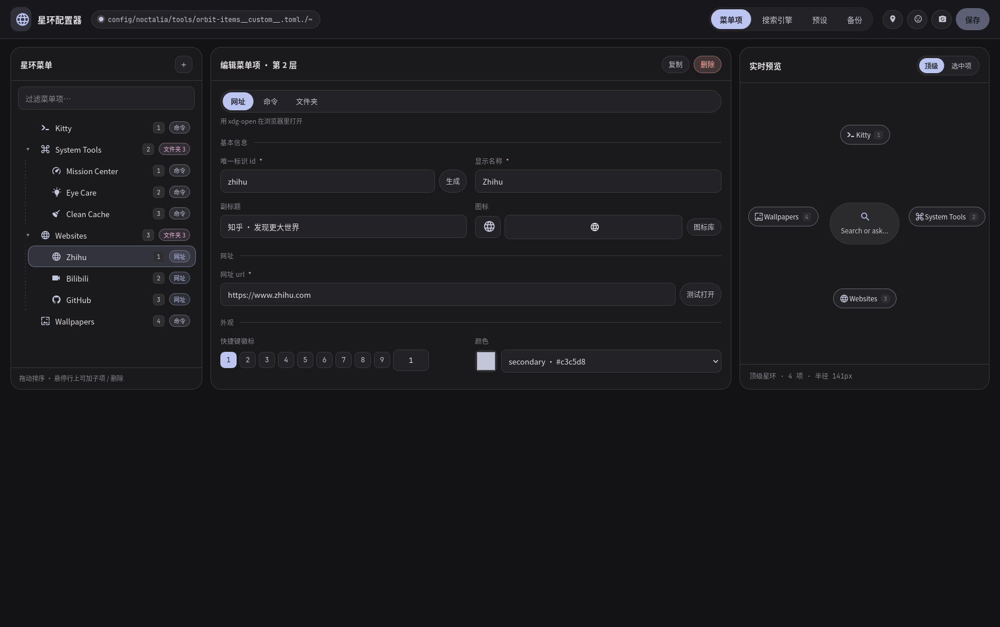
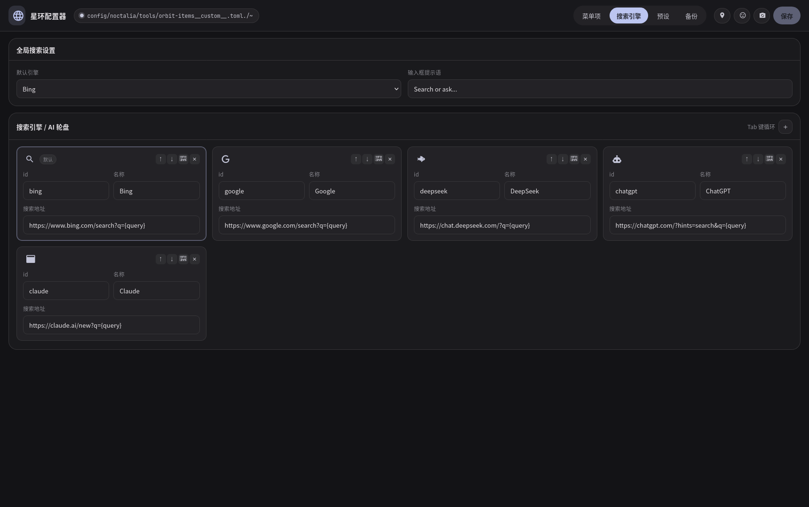
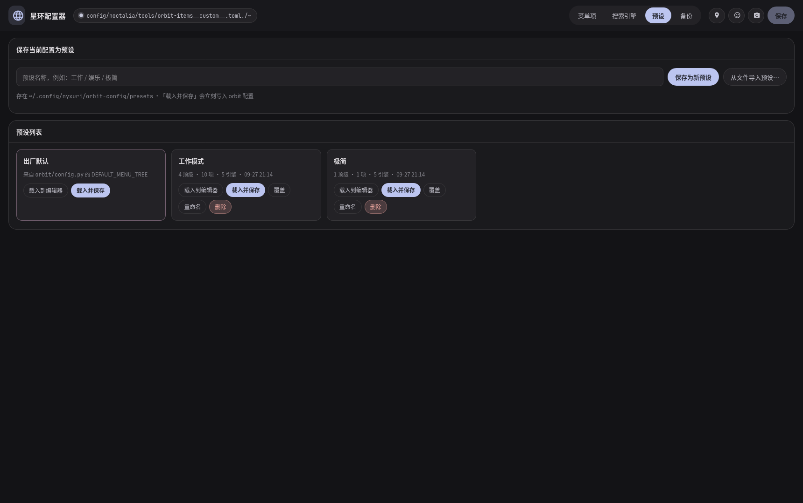
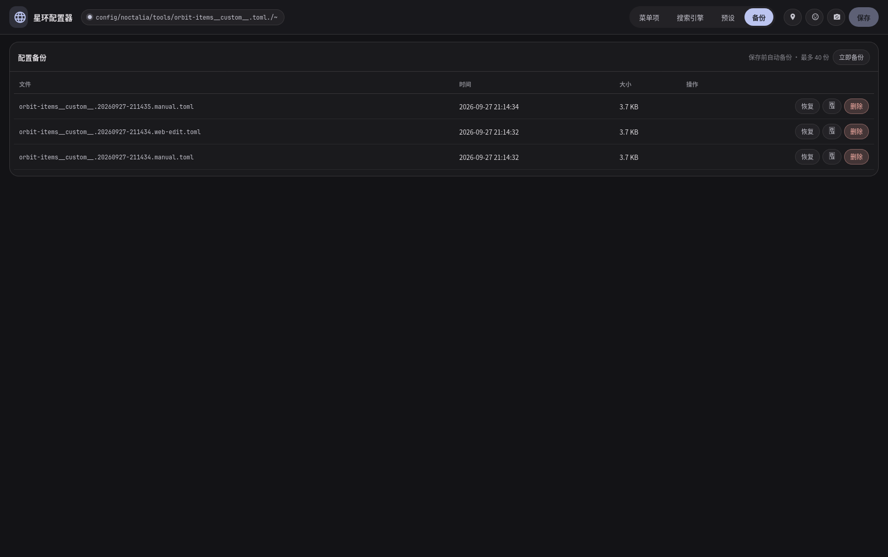
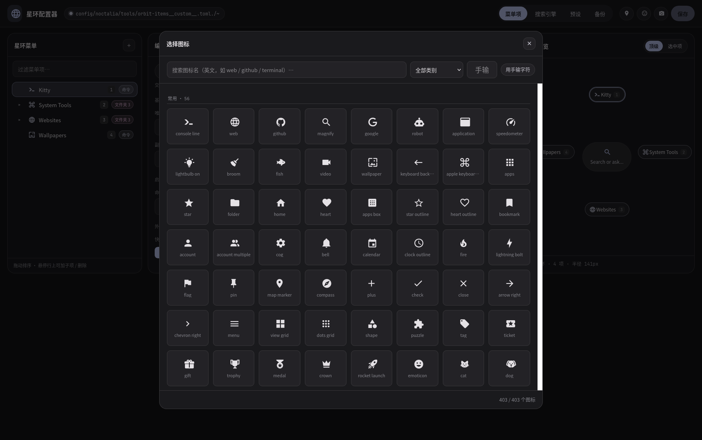

# 星环配置器 · Orbit Web Config

用浏览器图形化编辑 [Orbit 星环启动器](../../.config/noctalia/tools/orbit-launcher.py)
的配置：菜单项（应用 / 网址 / 文件夹）、搜索引擎轮盘、全局搜索设置，
以及导入导出、预设切换和一键备份恢复。

- 后端：**Python 3 标准库**（`http.server`），**零第三方依赖**
- 前端：原生 HTML / CSS / JS，**无构建步骤**
- 写入目标：`~/.config/noctalia/tools/orbit-items__custom__.toml`（dunder 协议，升级不覆盖）
- Orbit 是「无守护进程」设计，每次打开都重新读配置 → **保存后下次按快捷键打开就生效，无需重启任何服务**

---

## 快速开始

```bash
cd ~/Projects/orbit-config
python3 orbit-config.py            # 监听 127.0.0.1:8787 并自动打开浏览器
```

常用参数：

```bash
python3 orbit-config.py --no-browser        # 不自动开浏览器
python3 orbit-config.py --port 9000         # 换端口（0 = 自动挑空闲端口）
python3 orbit-config.py --token my-secret   # 额外要求 ?token=my-secret
python3 orbit-config.py --print-config      # 只把将要写出的 TOML 打到终端，不写盘
python3 orbit-config.py --verbose           # 打印每个 HTTP 请求
```

然后编辑，按 **Ctrl+S**（或点「保存」）写回。打开 Orbit 看一眼即可
（默认 `Mod+A`，走 `shell-action.sh radial-launcher`）。

---

## 界面说明

### 菜单项

| 区域 | 作用 |
| --- | --- |
| 左栏 | 星环菜单树。可展开文件夹、拖动或用 `↑ ↓` 重排、`＋` 添加子项、`⧉` 复制、`✕` 删除 |
| 中栏 | 选中项的编辑表单。类型分「网址 / 命令 / 文件夹」，另有 id、名称、副标题、图标、快捷键徽标、颜色 |
| 右栏 | 实时预览。按 Orbit 的径向布局近似还原环形菜单，支持「顶级 / 选中项」两种取景 |

界面上只保留必要文字，字段的详细说明放在标签的悬浮提示（`title`）里。
顶栏除了「保存」以外的操作都收成了图标按钮：`󰍎` 重新加载 · `󰇸` 导入 · `󰄅` 导出。

**三种类型**

- **网址** → 写 `url`，Orbit 用 `xdg-open` 打开。表单里有「测试打开」按钮。
- **命令** → 写 `cmd`，交给 `niri-scratch-toggle.sh` 启动（可写脚本路径）。
- **文件夹** → 写 `children`，展开成下一层星环。

切换类型**不会丢数据**：原类型的字段会暂存起来，切回去自动恢复（浏览器会话内有效）。
如果某一项当前“什么都干不了”（空文件夹 / 空网址 / 空命令），编辑区会弹红框提醒，
左侧树里的类型徽标也会变成红色 `⚠`。

**图标**：点「图标库」，从系统 Nerd Font 里提取的 403 个精选图标中挑选，
支持按名字搜索、按分类过滤，也可以直接手输任意 Nerd Font 字符。
图标数据由 `tools/build_icons.py` 解析本机字体生成，所以**显示的就是 Orbit 真正会渲染的字形**。

**颜色**：`color_key` 可选语义色键（`primary` / `secondary` / `tertiary` / …），
取值来自 Material You 动态调色板 `~/.cache/nyxuri/palette.toml`，
预览里的颜色和实际星环完全一致；也可以直接填 `#RRGGBB`。

**深链接**：`#items` / `#search` / `#presets` / `#backups` 可直接定位到某个标签页，方便加书签。

### 搜索引擎

编辑 `[search]`（默认引擎、输入框占位符）和 `[[search_engines]]`
（Orbit 里 Tab 键循环切换、Enter 执行搜索）。每个引擎有独立的图标。

### 预设

- **内置预设**「出厂默认」直接来自 `orbit/config.py` 的 `DEFAULT_MENU_TREE`，
  因为它是动态加载的，所以 Orbit 升级后这里的默认值也会跟着更新。
- 自定义预设存在 `~/.config/nyxuri/orbit-config/presets/*.json`。
- 操作：`载入到编辑器`（只改网页内容）、`载入并保存`（立刻写盘）、
  `用当前配置覆盖`、`重命名`、`删除`、`从文件导入预设`。

### 备份

每次保存前自动备份到 `~/.config/nyxuri/orbit-config/backups/`（最多保留 40 份，
文件名含时间戳和原因，如 `...20260927-202720.web-edit.toml`）。
可以「恢复」「下载」「删除」，也可以「立即备份」。

### 导入 / 导出

- **导出**：下载一份 `orbit-config-<时间戳>.json`，包含 `items`、`search`、`search_engines`。
- **导入**：支持三种输入 —— 本工具的导出 JSON、Orbit 原生的 `items` JSON 数组、
  或整份 TOML 文本。导入只载入编辑器，确认后再「保存」。

---

## 安全模型

这是个能改你桌面配置的本地服务，所以：

- 只监听 `127.0.0.1`，不接受外部连接。
- 校验 `Host` 头（拒绝 `evil.example.com` 之类的 DNS rebinding 攻击）。
- 校验 `Origin` 头（拒绝其它网页发起的跨站请求）。
- 写接口要求 `Content-Type: application/json`，浏览器会先发预检，跨站拿不到。
- 静态资源有白名单扩展名，并做了目录穿越防护。
- 可选 `--token`，URL 需带 `?token=...`。

---

## 写回行为

- 只写 `~/.config/noctalia/tools/orbit-items__custom__.toml`（优先级最高的一份）。
  如果当前生效的是更低优先级的文件，界面顶部会提示。
- 写之前先 `shutil.copy2` 备份，再用「临时文件 + `os.replace`」原子替换。
- 写完之后**立刻用 `tomllib` 读回来验证**；解析失败会自动回滚到备份。
- 校验分两级：
  - **错误**（会拒绝写入）：id 重复 / 名称为空 / 既没网址也没命令也没子菜单 / 引擎 id 重复 / 引擎缺少名称或 url。
  - **提醒**（照写不误）：icon 没填、url 不是 http(s)、`color_key` 不在调色板里、
    引擎 url 缺 `{query}`、`default_engine` 不在列表里。
- 空文件夹会写成 `children = []`。TOML 的数组表语法无法表达「零个 `[[items.children]]`」，
  而这个普通 key 是合法的，能让「文件夹」类型在保存/重载后不丢；Orbit 只判断
  `len(children) > 0`，所以对启动行为没有任何影响。

---

## 目录结构

```
orbit-config/
├── orbit-config.py              # 命令行入口
├── orbitconfig/
│   ├── paths.py                 # 配置路径 / 状态目录
│   ├── defaults.py              # 动态加载 orbit/config.py 的出厂默认
│   ├── toml_io.py               # TOML 序列化（含运行时字段清洗、转义）
│   ├── store.py                 # 读取 / 校验 / 写回 / 备份 / 预设 / 导入导出
│   ├── icons.py                 # 图标库加载
│   ├── palette.py               # Material You 调色板读取
│   ├── server.py                # 标准库 HTTP 服务 + REST API
│   └── nerd_icons.json          # 由字体生成（403 个图标）├── web/                         # 前端（index.html / style.css / app.js / favicon.svg）
├── docs/                        # 界面截图（由 tools/make_screenshots.mjs 生成）
├── tools/
│   ├── build_icons.py           # 从本机 Nerd Font 重新生成图标库
│   ├── smoke_frontend.mjs       # jsdom 前端冒烟测试（55 项断言）
│   ├── make_screenshots.mjs     # 生成 docs/ 里的界面截图
│   └── install-user-integration.sh
├── packaging/                   # .desktop / systemd unit / niri 键位片段
└── PLAN.md                      # 设计与取舍记录
```

## 界面截图



| 搜索引擎 | 预设 | 备份 | 图标库 |
| --- | --- | --- | --- |
|  |  |  |  |

> 截图里的「工作模式 / 极简」等预设只是为了演示，你的配置不会有这些项。

---

## 桌面集成（可选）

```bash
tools/install-user-integration.sh              # 安装 .desktop + systemd user unit
tools/install-user-integration.sh --uninstall  # 卸载
```

它只写 `~/.local/share/applications/orbit-config.desktop` 和
`~/.config/systemd/user/orbit-config.service`，**不动任何系统文件**。

想用快捷键打开，把 `packaging/niri-keybind.snippet.kdl` 里的内容粘到
`~/.config/niri/__custom__.kdl`（dunder 自定义文件，升级不会被覆盖）。
如果启用了 systemd 服务，键位里直接 `xdg-open http://127.0.0.1:8787/` 就行。

---

## 开发

```bash
# 重新生成图标库（换字体后跑一次）
python3 tools/build_icons.py                          # 自动找系统里的 Nerd Font
python3 tools/build_icons.py /path/to/SomeNerdFont.ttf

# 前端冒烟测试：真正启动页面、执行 app.js、模拟点击/输入/保存/重载
npm install --no-save jsdom
python3 orbit-config.py --port 8792 --no-browser &
node tools/smoke_frontend.mjs http://127.0.0.1:8792/

# 重新生成界面截图（输出到 docs/）
node tools/make_screenshots.mjs http://127.0.0.1:8792/ docs

# 后端自检：渲染 → 解析 → 与当前生效配置逐字段比较
python3 - <<'PY'
import tomllib, subprocess
from orbitconfig import store
c = store.normalize_payload(store.read_config())
out = subprocess.run(['python3', 'orbit-config.py', '--print-config'],
                     capture_output=True, text=True).stdout
p = tomllib.loads(out)
assert p['items'] == c['items'], 'items 不一致'
assert p['search_engines'] == c['search_engines'], 'engines 不一致'
assert p['search'] == c['search'], 'search 不一致'
print('✅ 序列化往返一致')
PY
```

### REST API

| 方法 | 路径 | 说明 |
| --- | --- | --- |
| GET | `/api/state` | 当前配置 + 调色板 + 路径 |
| POST | `/api/validate` | 只校验并返回将写出的 TOML，不落盘 |
| POST | `/api/config` | 校验 + 备份 + 原子写回 |
| GET | `/api/icons` | 图标库 |
| GET | `/api/palette` | 调色板 |
| GET/POST | `/api/backups` | 列出 / 新建备份 |
| POST | `/api/backups/restore` · `/api/backups/delete` | 恢复 / 删除 |
| GET | `/api/backups/<name>` | 下载某个备份 |
| GET/POST | `/api/presets` | 列出 / 保存预设 |
| GET | `/api/presets/<id>` | 读取预设（`__factory__` = 出厂默认） |
| POST | `/api/presets/apply` | 应用预设（`save` 决定是否写盘） |
| POST | `/api/presets/rename` · `/api/presets/delete` | 重命名 / 删除 |
| GET | `/api/export` | 导出 JSON |
| POST | `/api/import` | 导入 JSON / TOML 文本 |

---

## 故障排查

**图标显示成方块** → 浏览器没找到 JetBrainsMono Nerd Font。
`web/style.css` 里用的是 `@font-face { src: local(...) }`，列出的是
`JetBrainsMono Nerd Font` / `JetBrainsMono Nerd Font Mono` / `JetBrainsMonoNL Nerd Font`。
如果你的字体名不同，往 `local()` 列表里加一行，或用 `fc-list | grep -i nerd` 查真实族名。

**保存报「同一层级内 id 重复」** → 同级菜单项的 `id` 必须唯一，改掉其中一个即可。

**保存后 Orbit 没变化** → 确认写的是哪一份文件（界面上方会显示完整路径）。
Orbit 读的是优先级最高且存在的那一份；如果你手改过优先级更低的文件，改动不会生效。

**改坏了想回退** → 「备份」页找到保存前的那一份，点「恢复」。

**端口被占用** → `--port 0` 让系统自动分配，或换一个端口。
